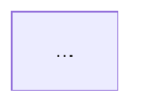
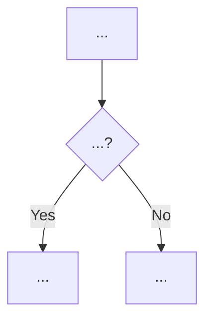
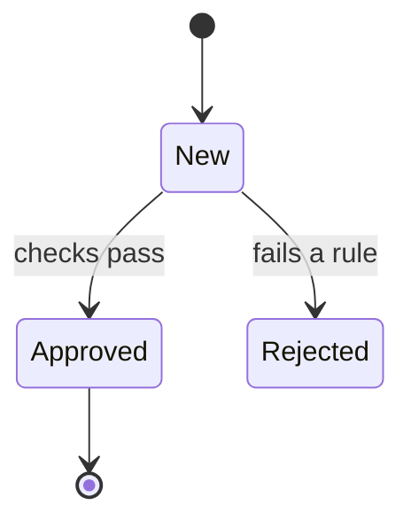

# Note templates

One template per note type. Fill in the parts that apply; drop sections that would be empty rather than writing "N/A".

The templates use **GitHub flavored Markdown** (the default format). **Writing Obsidian?** Translate each construct (links, callouts, `README.md` → `Home.md`) using `formats.md`.

Links in the templates are written from the note's own folder: `../Workflows/<Workflow>.md` from a note in `Domains/`, `Workflows/<Workflow>.md` from `README.md`. Encode spaces as `%20`.

Every note shares the same frontmatter shape:

```yaml
---
tags: [business-docs, <type>, <domain-slug>]   # type: home | domain | workflow | entity | rule | glossary
aliases: [<other names, code identifiers, translations>]
sources:                                       # repo-relative files or directories this note explains
  - app/Services/LeadService.php
  - app/Jobs/Leads/
updated: YYYY-MM-DD
---
```

`sources` is what update mode uses to know which notes to revisit when code changes, so list the files that really contain the logic (directories are fine for groups of files). Keep the list short and accurate.

Mermaid tips (GitHub and Obsidian both render mermaid, but syntax errors show as an error box):

- Quote labels that contain spaces or punctuation: `A["Lead arrives"] --> B{"Duplicate?"}`
- Avoid parentheses, `#`, `;` and quotes inside unquoted labels.
- In `stateDiagram-v2`, use simple state ids and give readable labels with `state "Waiting for buyer" as Waiting`.

---

## README.md (entry note; `Home.md` in Obsidian)

```markdown
---
tags: [business-docs, home]
aliases: [Index, Start here]
sources: []
updated: YYYY-MM-DD
---

# <App name>: how the business works

> [!NOTE]
> **TL;DR**
> **<App>** <does what> for **<whom>**.
> It makes money / creates value by <how>.

## What this app does

<2–4 short paragraphs, plain language. Who uses it, what goes in, what comes out.>

## The big picture

<One-sentence intro to the diagram.>

```mermaid
flowchart LR
  ...main actors and the main flow between domains...
```

## Business areas

- [<Domain A>](Domains/<Domain%20A>.md) — *one-line summary*
- [<Domain B>](Domains/<Domain%20B>.md) — *one-line summary*

## Key processes

- [<Workflow 1>](Workflows/<Workflow%201>.md) — *one-line summary*

## Start here if you are…

- **New to the business** → read the [Glossary](Glossary.md) first, then [<most central domain>](Domains/<Domain>.md)
- **Looking for a specific rule** → see the Rules section in each area

## Open questions

- <links to notes with `Unclear` callouts, if any>
```

---

## Domain note — `Domains/<Domain>.md`

A hub. Short, mostly links. Explains the area and points to its workflows, entities and rules.

```markdown
---
tags: [business-docs, domain, <domain-slug>]
aliases: []
sources: [<main dirs of this domain>]
updated: YYYY-MM-DD
---

# <Domain>

> [!NOTE]
> **TL;DR**
> <What this area is responsible for, in 2–3 lines.>

## Why it exists

<The business problem this area solves.>

## Who is involved

- **<Actor>** — *what they do here*

## How it fits together



## Processes

- [<Workflow>](../Workflows/<Workflow>.md) — *summary*

## Things it manages

- [<Entity>](../Entities/<Entity>.md) — *summary*

## Important rules

- [<Rule>](../Rules/<Rule>.md) — *summary*

<details>
<summary>Where in the code</summary>

- `app/...` — *what lives there*

</details>
```

---

## Workflow note — `Workflows/<Workflow>.md`

A process from trigger to outcome.

```markdown
---
tags: [business-docs, workflow, <domain-slug>]
aliases: []
sources: [...]
updated: YYYY-MM-DD
---

# <Workflow name>

> [!NOTE]
> **TL;DR**
> <What starts it → what happens → the outcome.>

Part of [<Domain>](../Domains/<Domain>.md).

## When does it start?

- <trigger: a user action, an API call, a schedule ("**every night at 02:00**"), an event>

## Step by step



1. **<Step>** — *plain explanation*
2. **<Step>** — ...

## Possible outcomes

- ✅ **<Happy outcome>** — ...
- ❌ **<Failure/rejection>** — *why it happens*

## Rules applied

- [<Rule>](../Rules/<Rule>.md) — *summary*

> **Example:** *A worked example with names and numbers.*

> [!WARNING]
> **Edge cases**
> - ...

<details>
<summary>Where in the code</summary>

- `app/...` — *role in this workflow*

</details>
```

---

## Entity note — `Entities/<Entity>.md`

A business object (Lead, Order, Invoice), its data that matters to the business, and its lifecycle.

```markdown
---
tags: [business-docs, entity, <domain-slug>]
aliases: [<ModelName>, <table_name>]
sources: [...]
updated: YYYY-MM-DD
---

# <Entity>

> [!NOTE]
> **TL;DR**
> <What it represents in the real world, and why it matters.>

See also: [<Glossary term>](../Glossary/<Term>.md) · [<Domain>](../Domains/<Domain>.md)

## What it represents

<Plain explanation + example.>

## What we know about it

- **<Business attribute>** — *meaning* (not every column — only the ones with business meaning)

## Lifecycle



- **<Status>** — *what it means and what moves it to the next status*

## Rules

- [<Rule>](../Rules/<Rule>.md) — *summary*

## Related

- **Belongs to** [<Entity>](<Entity>.md) · **has many** [<Entity>](<Entity>.md)

<details>
<summary>Where in the code</summary>

- Model: `app/Models/...`
- Statuses: `app/Enums/...`

</details>
```

---

## Rule note — `Rules/<Rule>.md`

One business rule, policy or calculation worth its own page.

```markdown
---
tags: [business-docs, rule, <domain-slug>]
aliases: []
sources: [...]
updated: YYYY-MM-DD
---

# <Rule name>

> [!NOTE]
> **TL;DR**
> <The rule in one sentence, with its key number.>

## The rule

<Conditions as bullets, with **bold** values.>

## Why it exists

<The reason, from comments/commits. Otherwise an Unclear callout:>

> [!IMPORTANT]
> **Unclear:** <what is unknown.>

> **Example:** *Concrete scenario.*

## Where it applies

- [<Workflow>](../Workflows/<Workflow>.md)

## Can it be changed?

<Config, per-customer overrides, feature flags — in business terms.>

<details>
<summary>Where in the code</summary>

- `app/...` · config `...`

</details>
```

---

## Glossary term — `Glossary/<Term>.md`

```markdown
---
tags: [business-docs, glossary]
aliases: [<plural>, <CodeName>, <translation>]
sources: [<where it's defined>]
updated: YYYY-MM-DD
---

# <Term>

> [!NOTE]
> **TL;DR**
> **<Term>**: <one-line plain definition>.

## Meaning

<2–3 short lines.>

> **Example:** *<Example in real life.>*

## In the code

Called `<Identifier>` *(e.g. model `Lead`, table `leads`, status `SOLD`)*.

## Related

- [<Entity>](../Entities/<Entity>.md) · [<Workflow>](../Workflows/<Workflow>.md) · [<Other term>](<Other%20term>.md)
```

---

## Glossary.md

```markdown
---
tags: [business-docs, glossary]
aliases: [Glossary index]
sources: []
updated: YYYY-MM-DD
---

# Glossary

> [!NOTE]
> **TL;DR**
> The words used in this business, in plain language. Start here if a term confuses you.

## A

- [<Term>](Glossary/<Term>.md) — *one-line definition*

## B

...
```
